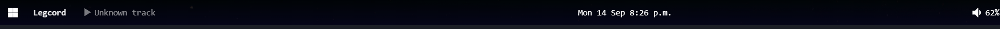

# my-bar

A widget pack for [zebar](https://github.com/glzr-io/zebar) on Windows. It puts one 42 pixel strip at the top of the screen, and the strip opens panels for media, system, storage, weather, battery, calendar, and window actions.



## What the bar does

The bar is one widget. Each part of it opens a panel widget:

| Part of the bar | Opens | Panel shows |
| --- | --- | --- |
| App mark (left) | `windows-menu` | Task manager, Settings, and the power actions |
| Bar settings in the Windows-icon menu | `settings-panel` | Spacing, visible readings, visualizer, and Pocket dinosaur |
| Foreground window name | `windows-menu` | The same menu |
| Now playing tile | `media-panel` | Track, artist, album, and transport buttons |
| Clock | `calendar-panel` | Month grid, agenda, and a search box |
| System tile | `system-panel` | CPU load and RAM use |
| Storage tile | `storage-panel` | Free space for each drive |
| Battery tile | `battery-panel` | Charge and time remaining |
| Weather tile | `weather-panel` | Temperature and the 5 day forecast |
| Volume tile | `controls-panel` | Volume and screen brightness |

One click closes a panel that is open. A click outside a panel closes it too.

Popups open directly beneath the tile you select, on that tile's display. Their
position is clamped to the display edges, including on monitors with different
scaling. Long panels scroll to stay on screen.

The bar docks to the top edge, so maximized windows stop below it. If no window is maximized, the bar floats 6 pixels from the edge with 9 pixel corners.

The window helper checks the Windows work area and the bar's topmost flag every
two seconds. If either is lost, it repairs the existing bar window's appbar
registration and position without taking focus. This recovers lost reservations
after sleep, Explorer restarts, or display changes; it uses physical monitor
coordinates so DPI scaling does not reserve the wrong height. Checks from
multiple monitors are serialized, and healthy reservations are left alone.

Recovery reads the fixed height from `zpack.json` once per helper startup and
scales it for each display. It never uses a window's temporary height as the
reservation size. An oversized window or work-area reservation is unhealthy;
recovery releases only this bar's old reservation before rebuilding its strip.
Oversized or vertically shifted shell results are rejected. Brief invalid
window sizes are allowed to settle for one second before repair, so recovery
does not race the initial WebView setup or a display transition.

## Shortcuts and gestures

**Volume and brightness.** You can change the volume and brightness straight from the volume tile on the bar:
- **Scroll** over the tile to raise or lower the volume by 2%.
- **Shift + scroll** over the tile to change the screen brightness by 5%.
- **Click and drag** left or right on the tile to scrub volume continuously.
- **Shift + drag** on the tile to scrub screen brightness.

**Now playing tile.** The media tile shows the current track and artist. When playback stops, the tile dims and remembers the last track rather than vanishing.

**Battery tile.** The charge is read every 30 seconds. A battery is one of the
few readings that comes from the driver through WMI, and asking for it every
couple of seconds made that refresh fail; the tile then kept its last number and
dimmed, which looked like a dead reading rather than an old one. If a read does
fail, the tile keeps the last value, dims it, and recreates the reader on a
widening delay (one minute, doubling to five) until readings flow again. A stale
number is dimmed only once it is older than three polls; the tooltip says when it
is the last reading rather than a live one.

**Bar settings.** Click the Windows icon, then **Bar settings**. A dedicated
window replaces the menu at the same position. Changes apply immediately across
your bars and persist across reloads. You can change compact spacing, choose
whether to show the app name, CPU/memory, storage and weather, and enable the
visualizer or dinosaur game.

**Playback visualizer.** Enable it in Bar settings. It only
appears while a current media session is playing, and disappears when paused,
stopped, or disabled, even if the media tile remembers the previous track.
Clicking the equalizer turns it off. This is a decorative playback animation,
not an audio spectrum: no microphone, audio capture, or extra helper is needed.
It respects reduced motion and starts off; your choice is remembered.

**Pocket dinosaur.** Enable it in Bar settings. A small, still dinosaur and a
**Run** button appear on the left. Click Run to turn the entire bar into a course:
the dinosaur runs from left to right beneath the real readings, then loops back
for a faster lap. The readings remain visible as landmarks, and return to normal
when you leave. Click the track, Space, or Up to jump; hold Down, S, or the right
mouse button to duck. P or the pause button pauses/resumes; Escape or × leaves.
Click or Space retries after a collision.

The course mixes cacti, cactus clusters, rocks, flying birds, gaps, data crates
near storage, and heat vents near CPU/memory. Jump over ground hazards and gaps;
duck beneath birds. Clearing consecutive hazards increases the bonus. The real
clock creates a checkpoint and briefly slows the whole game; retries return to
the clock after reaching it. The battery grants a one-hit shield. Playing media
leaves collectible notes. The corresponding reading gives a small hop when its
reward is collected, respecting reduced motion. These encounters do not change
volume, battery readings, system settings, or media playback.

It pauses when focus moves away, the page becomes hidden, or the bar changes
size. Best scores are saved locally.
The game starts disabled, loads only when enabled, renders at most 30 times per
second during play, and schedules no frames while idle, paused, or finished.
Pixel artwork uses separate running, jumping, crouching, and bird wing poses;
the small sprite images are cached once and reused when drawing frames.
It never changes the bar's height or its reserved screen space.

**Keyboard.** Tab to a bar control, then press Enter or Space to open it. Left
and Right move between visible controls; Home and End jump to either end. Esc
dismisses a panel.

The clock updates at minute boundaries instead of redrawing every tile once a
second. Popup resize requests are combined per frame and sent in order. The
visualizer uses CSS transforms with no JavaScript animation loop or added runtime
dependencies. Narrow displays hide secondary readings before controls overlap.

**Calendar panel.** While the calendar panel is open:
- `Ctrl+F` focuses the event search box.
- `R` reloads the calendar feeds.
- `Esc` closes event details or dismisses the panel.
- A banner appears at the top of the day view when an event starts in less than 15 minutes.

## Requirements

- Windows 10 or Windows 11.
- Zebar 3.x.
- PowerShell 5.1 or later. Windows supplies it.
- No API key. The weather panel reads open-meteo.com, and the calendar panel reads the feeds that you list.

## Install

1. Copy this folder to `%USERPROFILE%\.glzr\zebar\my-bar`.
2. Add the pack to `startupConfigs` in `%USERPROFILE%\.glzr\zebar\settings.json`:

```json
{
  "startupConfigs": [
    {
      "pack": "my-bar",
      "widget": "vanilla",
      "preset": "default"
    }
  ]
}
```

3. In the Zebar tray icon, click `Empty cache and reload configs`.

Note: the pack `name` field in `zpack.json` must stay `my-bar`. The value in `startupConfigs.pack` refers to this field, not to the folder name.

## Configuration

**Calendar feeds.** Make a file `%USERPROFILE%\.glzr\calendar-feeds.txt`. Put one iCalendar URL on each line. A line that starts with `#` is a comment. The panel reads this file at each refresh.

**Weather location.** The weather panel asks ipinfo.io for an approximate location, then asks open-meteo for the forecast. To use a fixed location, set the coordinates in the provider group in `weather-panel.html`.

**Brightness.** `scripts/brightness.ps1` changes the brightness of the built in panel through the WMI monitor classes. External monitors usually ignore this command.

**Private changes.** A file that ends in `.local` is yours. Git ignores these files.

## How it works

The pack has no build step. Each widget is a plain HTML page with an inline CSS link to `styles.css`. Zebar gives the pages live data through providers.

Run `node scripts/test-ui.mjs` for the dependency-free UI checks (Edge or Chrome
required). They use a simulated Zebar bridge, never change system settings, and
save screenshots in `resources/qa.local/`. Native window focus, docking, and
mixed-DPI positioning still need a check in a running Zebar instance.

Two parts of the operating system have no provider, so the pack reads them with PowerShell helpers in `scripts/`:

- `window-ctl.ps1` tracks the panel windows and closes a panel when a click lands outside it. If the bar's page goes away, the guard keeps watching, so a panel that outlives it can still be dismissed; a reloaded bar's guard takes over within a few seconds.
- `bar-dock.cs`, loaded by that same helper, repairs lost top-edge reservations and topmost state. Repairs are logged to `%TEMP%\zebar-window-ctl.log`.
- `brightness.ps1`, `power.ps1`, `specs.ps1`, and `calendar.ps1` do the tasks that a web page cannot do alone.

`zpack.json` gives each helper an exact `shellCommands` rule, so the pack asks for three commands and no more. Every helper is started with `-ExecutionPolicy Bypass`: this machine refuses unsigned scripts even though the policy reads `RemoteSigned`, and without that flag PowerShell exits before the script's first line — which is exactly how the panel guard stopped starting, silently, with no trace of its own.

## Layout

```
vanilla.html            the bar strip
*-panel.html            one page per panel
styles.css              all styles for the bar and the panels
assets/                 icons, weather and calendar readers, vendored libraries
scripts/                PowerShell helpers
resources/              preview image
zpack.json              widget and preset definitions
```

## Reference project

This pack started as a copy of the starter pack that ships with [zebar](https://github.com/glzr-io/zebar) (`glzr-io.starter`), by the zebar authors. The starter pack gives a buildless bar, a widget schema, and a reload model. This pack keeps that base and adds:

- Panel widgets for media, system, storage, weather, battery, calendar, and window actions.
- A PowerShell guard that closes a panel on a click outside its rectangle.
- A window size that follows the card inside it, so a panel has no dead strip.
- A docked top edge that shrinks the work area, so maximized windows stop below the bar.

The vendored files in `assets/vendor/` come from zebar and its dependencies. See the licenses of those projects.

## Docking diagnosis and verification

Zebar 3.3.1 registers its Windows appbar with no callback and has an explicit
TODO for `ABN_POSCHANGED` handling in
[its docking implementation](https://github.com/glzr-io/zebar/blob/v3.3.1/packages/desktop/src/common/windows/app_bar.rs).
The initial `top_most` and `dockToEdge` settings therefore do not guarantee that
the Windows reservation stays healthy. This pack adds a recovery check using
the same HWND, following the Windows `ABM_QUERYPOS` / `ABM_SETPOS`
[positioning protocol](https://learn.microsoft.com/en-us/windows/win32/shell/application-desktop-toolbars).
It does not use a second appbar or overwrite the desktop work area globally.

From this folder, `powershell.exe -NoProfile -File scripts/bar-dock.ps1` prints
each bar's physical bounds, monitor work area, and protection flags without
changing anything. Add `-Repair` for a manual recovery.

`powershell.exe -NoProfile -ExecutionPolicy Bypass -File scripts/test-bar-dock.ps1 -RegressionOnly`
runs the actual repair logic against a simulated Windows shell without changing
desktop windows. It covers oversized startup windows, stale reservations,
fractional DPI scaling, negative monitor coordinates, unsafe shell responses,
failed repairs, and repeated healthy checks.

Without `-RegressionOnly`, `scripts/test-bar-dock.ps1` also verifies the live bar's health. Its optional
`-ExerciseRecovery` switch briefly removes the bar's reservation and topmost
flag, checks recovery, and checks repeated calls for duplicate reserved space.
Use that switch only when ready for the desktop layout to change briefly.
Add `-ObserveAutomaticRecovery` to have the test wait for the running bar's
helper to perform the repairs instead of calling the repair method directly.
The automatic guard should recover a lost reservation within about two seconds,
or up to four seconds when it first needs to let invalid geometry settle, while
its helper and the Windows shell are responsive. Diagnostics include both the
expected DPI-scaled height and actual window bounds; repair logs also record the
actual height. Restart Zebar after changing recovery code to replace helpers
that already loaded the previous version.

## Limitations

- Windows only. `dockToEdge` does nothing on Linux and macOS, and the brightness helper uses WMI.
- The bar is one widget, so a broken provider can hide its tile until the next reload.
- Zebar holds port `127.0.0.1:6124`. Start one instance only.
- The pack is personal. The panel sizes and the offsets fit a 2880 x 1800 screen.
- Reserved work area constrains normal maximized and snapped windows. Fullscreen apps and windows deliberately placed outside the work area can still overlap the strip.

## License

GPL-3.0. See `LICENSE`. This pack is a derivative of the zebar starter pack, which zebar publishes under GPL-3.0.
